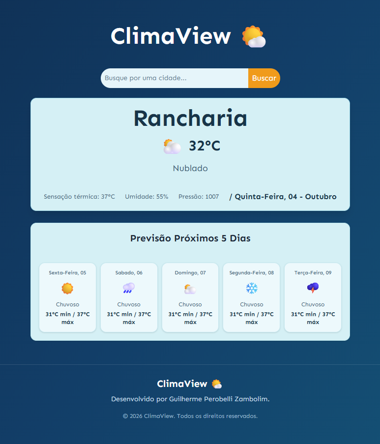

# ClimaView

**Consulte o clima. Acompanhe a previsão. Planeje seu dia!**

O ClimaView é uma aplicação web desenvolvida para apresentar informações meteorológicas de maneira simples, intuitiva e visualmente agradável.

A proposta é permitir que o usuário consulte as condições climáticas de diferentes cidades, acompanhando informações como temperatura, sensação térmica, umidade, pressão atmosférica e previsão para os próximos dias.

O projeto está sendo desenvolvido gradualmente, começando pela construção da interface visual e avançando para a implementação das funcionalidades e integração com uma API meteorológica.

## Preview



## Funcionalidades

**Implementadas**

- Interface com fundo animado em degradê.
- Campo de pesquisa para cidades.
- Card principal para apresentação das condições climáticas.
- Exibição de temperatura, sensação térmica, umidade e pressão atmosférica.
- Área dedicada à previsão do tempo para os próximos cinco dias.
- Componentes reutilizáveis desenvolvidos com React.
- Identidade visual personalizada com tema em tons de azul e detalhes em laranja.

**Planejadas**

- Implementar a pesquisa de informações meteorológicas por cidade.
- Integrar uma API de previsão do tempo.
- Exibir informações climáticas de forma dinâmica.
- Atualizar os dados conforme a cidade pesquisada.
- Apresentar a previsão real para os próximos cinco dias.
- Exibir ícones de acordo com as condições meteorológicas.
- Implementar estados de carregamento e tratamento de erros.
- Aprimorar a responsividade para dispositivos móveis.

**Status do projeto:** em desenvolvimento. A interface visual está estruturada e a implementação das funcionalidades será realizada nas próximas etapas.

## Tecnologias utilizadas

- React: construção da interface e organização dos componentes.
- TypeScript: tipagem e organização do código.
- Tailwind CSS: estilização e construção do layout.
- Vite: ambiente de desenvolvimento e inicialização da aplicação.

## Informações meteorológicas

A aplicação foi projetada para apresentar as seguintes informações:

- Cidade: localização consultada pelo usuário.
- Temperatura atual: temperatura registrada na cidade.
- Condição climática: descrição das condições meteorológicas.
- Sensação térmica: temperatura percebida.
- Umidade: percentual de umidade do ar.
- Pressão atmosférica: pressão registrada no momento da consulta.
- Previsão para os próximos cinco dias: temperaturas mínimas e máximas e condições climáticas previstas.

## Como executar o projeto

1. Faça o download ou clone este repositório.
2. Abra a pasta do projeto no editor de código.
3. Abra o terminal na pasta do projeto.
4. Instale as dependências:
```bash
npm install
```
5. Inicie o servidor de desenvolvimento:
```bash
npm run dev
```
6. Acesse o endereço disponibilizado pelo Vite no terminal.

## Estrutura do projeto
```text
weather-app/
├── docs/
│   └── images.png
├── public/
├── src/
│   ├── assets/
│   ├── components/
│   │   ├── Aside.tsx
│   │   ├── Card.tsx
│   │   ├── Footer.tsx
│   │   └── Header.tsx
│   ├── index.css
│   └── main.tsx
├── index.html
├── package.json
├── package-lock.json
├── tsconfig.json
├── vite.config.ts
└── README.md
```

## Objetivo do projeto

O objetivo do ClimaView é desenvolver uma aplicação de consulta meteorológica que apresente informações climáticas de maneira clara, organizada e acessível.

Além de proporcionar uma experiência visual agradável, o projeto busca colocar em prática meus conhecimentos de React, TypeScript, estilização com Tailwind CSS, consumo de APIs e manipulação de dados.

A proposta é construir uma aplicação funcional, explorando a integração entre interface e informações meteorológicas.

## Próximos passos

- Implementar a lógica de pesquisa por cidade.
- Escolher e integrar uma API meteorológica.
- Tornar os componentes dinâmicos utilizando propriedades (Props).
- Exibir informações meteorológicas reais.
- Implementar a previsão do tempo para os próximos cinco dias.
- Adicionar estados de carregamento e tratamento de erros.
- Melhorar a responsividade para dispositivos móveis.
- Aprimorar a interface de acordo com as condições climáticas.

## 👨‍💻 Autor
- Guilherme Perobelli Zambolim
- [GitHub](https://github.com/GuilhermePerobelliZambolim)
